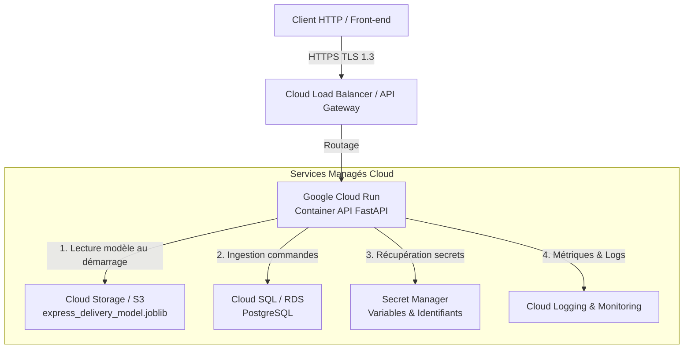

# ADR-003 : Plateforme d'hébergement et services Cloud pour la mise en production

* **Statut** : Accepté
* **Date** : 2026-10-29
* **Projet** : Éligibilité Livraison Express (`livraison-express-lite`)
* **Cadre** : M2 IA dans le Cloud - TP1 (Industrialisation & Architecture MLOps)
* **Décideurs** : Équipe Architecture & MLOps

---

## 1. Contexte et Problématique

L'application de prédiction d'éligibilité à la livraison express a été modélisée et empaquetée sous forme de service conteneurisable (`livraison-express-lite`). Pour le passage à l'échelle et l'exploitation opérationnelle, il est nécessaire de définir :
1. **La typologie d'hébergement** : Local, On-Premise (datacenter d'entreprise) ou Cloud public ?
2. **Le modèle de service Cloud** : IaaS (machines virtuelles), CaaS (Containers-as-a-Service / Serverless), ou PaaS ML propriétaire (SageMaker, Vertex AI) ?
3. **Le catalogue de services managés** requis pour supporter l'inférence temps réel, la haute disponibilité, le stockage des données et des artefacts ML, ainsi que la gestion des secrets.

---

## 2. Facteurs de Décision (Decision Drivers)

* **Élasticité et Scalabilité automatique** : Capacité à absorber des pics de charge (ex. heures de repas, promotions e-commerce) et à réduire l'allocation de ressources à zéro lors des périodes creuses (*Scale-to-Zero*).
* **Faible charge opérationnelle (NoOps / Serverless)** : Minimiser la gestion des systèmes d'exploitation, des correctifs de sécurité et de l'orchestration matérielle.
* **Latence d'inférence** : Temps de réponse réseau et calcul sous la barre des 100 ms (P95).
* **Portabilité et Absence de Vendor Lock-in** : Utilisation d'artefacts standardisés (images de conteneurs OCI Docker, Scikit-learn, MLflow) sans dépendance stricte aux API d'un fournisseur unique.
* **Coût d'exploitation** : Facturation à l'usage réel (au million de requêtes et à la milliseconde de CPU/RAM consommée).

---

## 3. Options Considérées

| Option | Description | Avantages | Inconvénients / Limites |
| :--- | :--- | :--- | :--- |
| **Option 1 : Local / Bare-Metal** | Exécution sur serveurs physiques dédiés en local. | • Contrôle physique absolu • Aucun coût de bande passante cloud | • Aucune élasticité automatique • Maintenance matérielle lourde • Disponibilité limitée à un site unique |
| **Option 2 : On-Premise (Cluster Kubernetes privé)** | Déploiement sur infrastructure interne via OpenShift / K8s. | • Conformité souveraine stricte • Mutualisation de serveurs existants | • Coûts d'infrastructure fixes considérables • Équipe d'administration dédiée 24/7 nécessaire |
| **Option 3 : Cloud IaaS (VMs EC2 / Google Compute Engine)** | Déploiement du conteneur dans des machines virtuelles managées. | • Flexibilité totale sur l'OS et le runtime • Configuration réseau avancée | • Facturation continue (24h/24) même à vide • Gestion manuelle des AMI, patches OS et de l'autoscaling |
| **Option 4 : Cloud CaaS / Serverless Conteneurisé (Google Cloud Run / AWS ECS Fargate)** | Déploiement d'images de conteneurs standard sans gestion de serveurs sous-jacents. | • **Scale-to-zero et autoscaling instantané** • Zéro gestion d'infrastructure (Serverless) • Facturation à la requête et au temps de calcul réel • Image Docker standard 100% portable | • Démarrage à froid (*cold start*) si non provisionné (mitigé par une instance minimale `min-instances=1`) |
| **Option 5 : PaaS ML Managé (AWS SageMaker / GCP Vertex AI Endpoints)** | Hébergement managé spécifique au Machine Learning. | • Fonctionnalités MLOps intégrées (monitoring drift natif) • GPU managés | • Coût horaire élevé par instance d'inférence • Verrouillage propriétaire important (APIs SDK spécifiques) |

---

## 4. Décision Retenue

Nous retenons l'**Option 4 : Cloud Public Conteneurisé Serverless (CaaS)**, articulé autour de **Google Cloud Run** (ou **AWS ECS Fargate** en environnement AWS).

### Justification de la décision :
1. **Adéquation avec l'architecture du projet** : L'API FastAPI du projet est *stateless* (sans état interne) : le modèle est chargé en mémoire au démarrage via [`Core(load_model=True)`](file:///d:/Cours/m2/IA%20dans%20le%20cloud/tp1/src/livraison_express_lite/core/core.py), rendant chaque réplica de conteneur autonome et parallélisable à l'infini.
2. **Standard ouvert OCI / Docker** : L'application est packagée dans une image Docker standard. Elle s'exécute identiquement en local, sur Cloud Run, sur AWS Fargate ou sur un cluster Kubernetes, éliminant tout verrouillage technologique.
3. **Optimisation économique (FinOps)** : Grâce au *Scale-to-Zero*, l'infrastructure ne coûte rien pendant les heures de fermeture nocturne ou creuses, et scale automatiquement lors des afflux de commandes.

---

## 5. Cartographie des Services Cloud (GCP vs AWS)

| Rôle dans l'Architecture | Google Cloud Platform (GCP) | Amazon Web Services (AWS) | Rôle dans `livraison-express-lite` |
| :--- | :--- | :--- | :--- |
| **Inférence temps réel** | **Cloud Run** | **ECS Fargate** | Exécution conteneurisée de FastAPI et du modèle de prédiction |
| **Registre de conteneurs** | **Artifact Registry** | **Amazon ECR** | Stockage et scan de vulnérabilités de l'image Docker |
| **Stockage d'artefacts ML** | **Cloud Storage (GCS)** | **Amazon S3** | Dépôt des versions `.joblib`, `model_card.json` et `metrics.json` |
| **Base de données OLTP** | **Cloud SQL for PostgreSQL** | **Amazon RDS PostgreSQL** | Persistance des commandes (`OrderRepository`) |
| **Gestion des secrets** | **Secret Manager** | **AWS Secrets Manager** | Injection sécurisée de `DATABASE_URL` et des tokens sans fichier `.env` en dur |
| **Observabilité & Métriques** | **Cloud Logging & Monitoring** | **Amazon CloudWatch** | Centralisation des logs Uvicorn, latences et taux d'erreurs HTTP |
| **Serveur de Tracking ML** | **Cloud Run (MLflow)** | **EC2 / Fargate (MLflow)** | Centralisation des runs d'entraînement et comparaison de métriques |

---

## 6. Conséquences

### Positives :
* **Déploiement continu simplifié** : Intégration fluide dans une chaîne CI/CD (GitHub Actions vers Artifact Registry puis Cloud Run).
* **Isolation stricte** : Chaque conteneur s'exécute dans une sandbox gVisor sécurisée avec ses propres quotas mémoire et CPU.
* **Haute disponibilité native** : Redondance multi-zones automatique sans configuration manuelle de clustering.

### Compromis acceptés :
* **Latence de démarrage à froid (*Cold Start*)** : Lors d'une montée en charge depuis zéro instance, le démarrage du conteneur et le chargement du `.joblib` en mémoire prennent ~1 à 2 secondes.  
  *Mitigation :* En production, nous configurons `--min-instances 1` pour conserver au moins une instance chaude en permanence.

