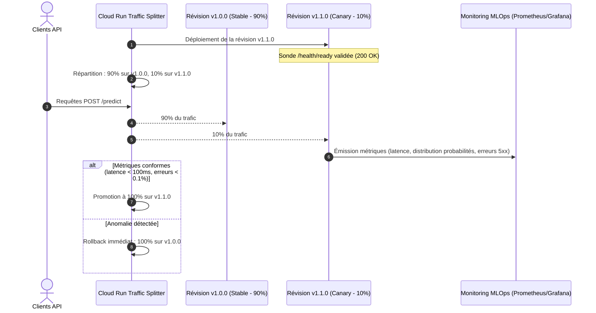

# ADR-004 : Stratégie de déploiement et cycle de vie des modèles ML

* **Statut** : Accepté
* **Date** : 2026-10-29
* **Projet** : Éligibilité Livraison Express (`livraison-express-lite`)
* **Cadre** : M2 IA dans le Cloud - TP1 (Industrialisation & Architecture MLOps)
* **Décideurs** : Équipe Architecture & MLOps

---

## 1. Contexte et Problématique

La mise en production d'un service de Machine Learning implique de déployer non seulement du code applicatif (API FastAPI), mais aussi de nouveaux artefacts de modèles issus des entraînements successifs (`MLTrainer`).
Une interruption de service ou la livraison d'un modèle défaillant (surapprentissage, régression de performance, latence anormale) impacte directement l'expérience client et la logistique des commandes.

Comment concevoir la stratégie de déploiement pour :
1. Garantir un **déploiement sans interruption de service (*Zero Downtime*)** ?
2. Valider le comportement du nouveau modèle sur un trafic réel restreint avant généralisation ?
3. Permettre un **rollback immédiat** en cas d'anomalie détectée en production ?

---

## 2. Facteurs de Décision (Decision Drivers)

* **Disponibilité (SLA 99.9%)** : Zéro temps d'arrêt lors du remplacement d'une version de modèle ou de code.
* **Maîtrise du risque ML (Model Safety)** : Capacité à tester un nouveau modèle sur 5% ou 10% du trafic réel sans impacter 100% des utilisateurs.
* **Vitesse de rollback** : Capacité à revenir à la version précédente en moins de 30 secondes en cas d'incident.
* **Compatibilité avec les sondes de santé** : Utilisation stricte des endpoints `/health` (liveness) et `/health/ready` (readiness) exposés par l'API.

---

## 3. Options Considérées

| Stratégie | Description | Avantages | Inconvénients / Risques |
| :--- | :--- | :--- | :--- |
| **Option 1 : Remplacement direct (*Recreate*)** | Arrêt de l'ancienne version puis démarrage de la nouvelle. | • Très simple à orchestrer • Aucune coexistence de versions | • **Interruption de service garantie** (downtime) • Inacceptable en production |
| **Option 2 : Mise à jour progressive (*Rolling Update*)** | Remplacement graduel instance par instance des conteneurs. | • Zéro downtime • Économie de ressources | • Risque de délivrer une mauvaise version à 100% des utilisateurs si le problème apparaît après le roll-out |
| **Option 3 : Déploiement Bleu/Vert (*Blue/Green*)** | Déploiement d'un environnement miroir complet (Green) puis bascule instantanée du routeur. | • Zéro downtime • Validation préalable sur l'environnement complet • **Rollback instantané (1 clic)** | • Doublement temporaire des ressources allouées pendant la transition |
| **Option 4 : Déploiement Canari (*Canary Release*)** | Routage progressif d'un pourcentage faible de trafic (ex: 5% vers v2, 95% vers v1) avec observation des métriques. | • **Risque métier minimal** • Comparaison directe A/B des performances et de la distribution des scores | • Nécessite un routeur de trafic avancé (Cloud Run Traffic Splitting, Envoy ou Istio) |

---

## 4. Décision Retenue

Nous retenons une stratégie combinée **Canary Release (pour les nouveaux modèles ML)** et **Blue/Green (pour les montées de versions majeures de code)**, exploitant nativement les capacités de **Traffic Splitting de Cloud Run** (ou d'un API Gateway / Ingress).

### Rôle central des sondes de santé dans le déploiement :
1. **Liveness Probe (`GET /health`)** :
   Vérifie que le serveur Uvicorn est vivant et capable d'accepter des connexions TCP/HTTP. En cas de blocage ou d'échec répété, le conteneur est redémarré.
2. **Readiness Probe (`GET /health/ready`)** :
   Vérifie que la brique d'inférence est prête (modèle Scikit-learn désérialisé et chargé en mémoire RAM via `Core`). Tant que la sonde renvoie `503 Service Unavailable`, le routeur de trafic **n'envoie aucune requête client** sur cette révision.

---

## 5. Critères de Déclenchement du Rollback Automatique

Le basculement vers la version précédente (*Auto-rollback*) se déclenche automatiquement si l'une des conditions suivantes est observée pendant les 15 premières minutes du Canary :
1. **Taux d'erreurs HTTP 5xx > 0.5%** sur la révision Canary.
2. **Latence P95 > 150 ms** sur l'endpoint `POST /predict`.
3. **Dérive de prédiction (*Prediction Drift*)** : proportion de commandes jugées éligibles (`decision == "oui"`) s'écartant de plus de 20% par rapport à la distribution de référence sans justification saisonnière.

---

## 6. Conséquences

### Positives :
* **Tolérance aux pannes maximale** : Les utilisateurs finaux ne sont jamais confrontés à un service indisponible pendant les déploiements.
* **Validation statistique réelle** : Possibilité de tester la stabilité d'un nouveau modèle en conditions de production avant de lui confier l'intégralité du volume logistique.

### Compromis acceptés :
* **Nécessité d'une observabilité fine** : Requiert une collecte rigoureuse des logs et métriques en temps réel pour décider objectivement de la promotion ou de l'annulation d'une révision.

