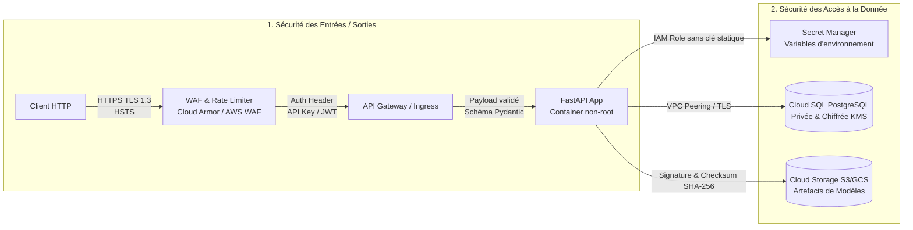

# ADR-005 : Sécurisation des flux d'entrées/sorties et protection des accès aux données

* **Statut** : Accepté
* **Date** : 2026-10-29
* **Projet** : Éligibilité Livraison Express (`livraison-express-lite`)
* **Cadre** : M2 IA dans le Cloud - TP1 (Industrialisation & Architecture MLOps)
* **Décideurs** : Équipe Architecture & MLOps

---

## 1. Contexte et Problématique

Dans un environnement de production Cloud, une API d'inférence Machine Learning traitant des données de commandes e-commerce (`OrderEntity`) est exposée à divers vecteurs de cyberattaques :
1. **Vulnérabilités sur les flux d'entrées/sorties** : Déni de service (DoS/DDoS), injection de charges utiles malformées, interception de requêtes en clair, exploitation d'erreurs logicielles via fuite de stacktraces.
2. **Risques sur les données et artefacts** : Fuite de données personnelles ou commerciales, vol ou altération des modèles Scikit-learn (`.joblib`), accès non autorisé à la base de données de persistance.

Comment garantir la sécurité de bout en bout selon le principe de **Défense en Profondeur** (*Defense in Depth*) et du **Moindre Privilège** (*Least Privilege*) ?

---

## 2. Facteurs de Décision (Decision Drivers)

* **Conformité RGPD et Sécurité des Données** : Chiffrement systématique au repos et en transit.
* **Intégrité du Modèle ML** : Prévention des attaques d'empoisonnement d'artefacts (*Model Poisoning*) et d'exécution de code arbitraire lors de la désérialisation Joblib.
* **Robustesse de l'API** : Rejet strict des requêtes non conformes dès la frontière d'entrée, sans surcharger les composants métier.
* **Zéro Clé Statique en Dur (12-Factor)** : Aucune chaîne de connexion, mot de passe ou clé d'API ne doit figurer dans le code source ou l'image Docker.

---

## 3. Architecture de Sécurité Retenue

---

## 4. Mesures de Sécurisation des Entrées et Sorties (Inbound / Outbound)

### 4.1. Chiffrement et Transport Sécurisé
* **HTTPS Strict & TLS 1.3** : Chiffrement obligatoire de toutes les communications avec certificat SSL/TLS managé et renouvellement automatique.
* **En-têtes de sécurité HTTP** : Configuration des en-têtes `Strict-Transport-Security` (HSTS), `X-Content-Type-Options: nosniff`, et `X-Frame-Options: DENY`.

### 4.2. Authentification et Contrôle d'Accès
* **Authentification par API Key / Bearer JWT** : Chaque appel sur `/predict` doit être authentifié via un en-tête `Authorization: Bearer <token>` ou `X-API-Key`.
* Les sondes `/health` et `/health/ready` restent accessibles sans authentification pour permettre les vérifications par l'orchestrateur (Load Balancer / Cloud Run).

### 4.3. Validation Stricte des Entrées (Fail Fast)
* **Validation de schéma Pydantic / OpenAPI** :
  * Contrôle des types, des énumérations (`weather: normal, pluie, neige, orage`, `delivery_zone`, `customer_type`).
  * Bornage strict des valeurs numériques (`hour: 0..23`, `distance_km >= 0`, `carrier_capacity: 0.0..1.0`).
  * Toute anomalie entraîne un rejet immédiat avec le code HTTP **`422 Unprocessable Entity`**, protégeant le pipeline ML de données aberrantes ou corruptrices.
* **Limitation de taille du payload (*Request Body Size Limit*)** : Rejet automatique des requêtes dépassant 10 Ko pour prévenir les attaques par déni de mémoire.
* **Rate Limiting & Protection DoS** : Limitation à 100 requêtes / minute par client au niveau de la passerelle (API Gateway / Cloud Armor).

### 4.4. Assainissement des Sorties et Gestion des Erreurs
* **Masquage des traces d'erreurs en production** : Les exceptions internes (`Exception`) sont interceptées et journalisées côté serveur avec un identifiant de corrélation (`request_id`). Le client reçoit uniquement un message générique avec code `500` ou `503`, sans divulgation de code interne, de structure de base de données ou de chemins de fichiers.

---

## 5. Mesures de Sécurisation des Accès à la Donnée (Data at Rest / In Transit)

### 5.1. Principe du Moindre Privilège (IAM sans clés statiques)
* Le conteneur s'exécute sous une identité de service managée (**Service Account GCP** ou **IAM Role AWS ECS**).
* **Zéro secret dans le code ou l'image Docker** : Les accès aux buckets et à la base de données sont accordés par jetons éphémères générés dynamiquement par le Cloud Provider (Instance Metadata Service).
* Rôles strictement limités :
  * Droit de **lecture seule** sur le bucket d'artefacts du modèle (`roles/storage.objectViewer`).
  * Droit de **lecture/écriture** limité à la table `orders` de la base de données.

### 5.2. Chiffrement des Données au Repos (*At Rest*)
* **Base de données relationnelle** : Chiffrement des volumes PostgreSQL via **AES-256** managé par Cloud KMS / AWS KMS.
* **Artefacts ML (`.joblib`, `metrics.json`)** : Chiffrement côté serveur (SSE) sur Cloud Storage / S3.

### 5.3. Isolation Réseau et Cloisonnement (VPC Private Access)
* **Aucune IP publique pour la base de données** : Le serveur PostgreSQL est déployé dans un sous-réseau privé d'un Virtual Private Cloud (VPC).
* Les conteneurs Cloud Run / ECS communiquent avec la base exclusivement via un **Connecteur VPC Access** (ou Cloud SQL Auth Proxy), empêchant toute tentative d'intrusion depuis l'Internet public.

### 5.4. Intégrité des Modèles ML (Sécurité de la désérialisation)
* La désérialisation de fichiers Joblib/Pickle pouvant présenter des risques d'exécution de code si l'artefact est altéré :
  * Calcul et vérification d'une **empreinte cryptographique SHA-256** de l'artefact `express_delivery_model.joblib` lors du chargement.
  * Restriction stricte des permissions d'écriture sur le bucket d'artefacts (seul le pipeline de CI/CD d'entraînement a le droit d'écrire ou remplacer un modèle).

---

## 6. Synthèse des Exigences de Sécurité

| Périmètre | Menace Identifiée | Contre-mesure Adoptée |
| :--- | :--- | :--- |
| **Entrées** | Injection de données corrompues / DoS | Validation Pydantic V2, bornage, Rate Limiting (100 req/min) |
| **Entrées** | Interception réseau / Man-in-the-Middle | HTTPS obligatoire, TLS 1.3, HSTS |
| **Sorties** | Fuite d'informations d'infrastructure | Réponses standardisées, masque des stacktraces en production |
| **Accès Données** | Vol d'identifiants de base de données | IAM Service Accounts, Secret Manager, aucune clé statique |
| **Données** | Compromission de disque physique | Chiffrement AES-256 au repos via Cloud KMS |
| **Données** | Accès non autorisé à la base SQL | Base privée sans IP publique, transit via connecteur VPC |
| **Modèle ML** | Empoisonnement d'artefact / Exécution de code | Bucket en écriture verrouillée, vérification de checksum SHA-256 |
