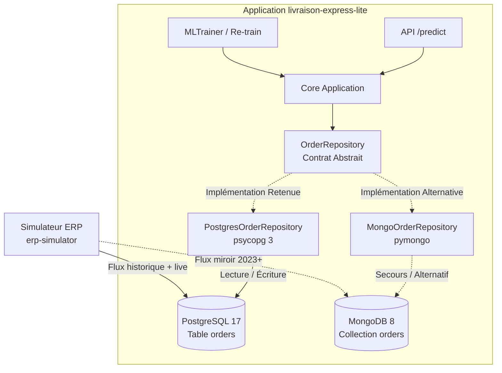

# ADR-006 : Choix du SGBD pour l'intégration des commandes ERP (PostgreSQL vs MongoDB)

* **Statut** : Accepté
* **Date** : 2026-10-29
* **Projet** : Éligibilité Livraison Express (`livraison-express-lite`)
* **Cadre** : M2 IA dans le Cloud - TP1 & TP4 (Intégration de données ERP & MLOps)
* **Décideurs** : Équipe Architecture & MLOps

---

## 1. Contexte et Problématique

Le simulateur ERP externe (`erp_simulator`) alimente deux systèmes de gestion de bases de données distincts :
1. **PostgreSQL** : base de données relationnelle SQL contenant un historique long (depuis 2015) et le flux temps réel.
2. **MongoDB** : base de données orientée documents NoSQL contenant un historique récent (depuis 2023) et le même flux temps réel.

Notre application doit intégrer ces données via l'abstraction [`OrderRepository`](file:///d:/Cours/m2/IA%20dans%20le%20cloud/tp1/src/livraison_express_lite/infrastructure/order_repository.py) afin :
- De servir les prédictions unitaires temps réel (`get`, `save`).
- D'extraire l'ensemble des commandes pour réentraîner périodiquement le modèle de Machine Learning (`get_all`, `count`).
- De gérer les évolutions historiques de schéma (colonnes `weekend` absentes avant juillet 2015, `preparation_time_min` absentes avant juillet 2017).

---

## 2. Facteurs de Décision (Decision Drivers)

* **Intégrité et Typage des Données ML** : Le modèle Scikit-learn exige un vecteur tabulaire strict composé de 12 variables numériques et catégorielles.
* **Volume d'historique disponible pour l'apprentissage** : Plus le volume historique labellisé est riche (2015-présent vs 2023-présent), plus le modèle peut apprendre des tendances saisonnières solides.
* **Performance d'extraction par lot (*Batch ETL throughput*)** : Capacité à extraire des dizaines de milliers d'enregistrements en un temps minimal pour le réentraînement.
* **Évolution de schéma et Traçabilité** : Capacité à auditer les migrations de données (table `schema_migrations`).
* **Inversion de Dépendance (DIP - SOLID)** : L'application `livraison-express-lite` ne doit pas dépendre du moteur technique sous-jacent.

---

## 3. Options Considérées

| Critère d'évaluation | Option A : PostgreSQL (Relationnel SQL) | Option B : MongoDB (NoSQL Document) |
| :--- | :--- | :--- |
| **Profondeur de l'historique** | **10 ans (depuis 2015)** : historique complet (2015-2022 + 2023-présent) | **2 ans (depuis 2023)** : historique partagé récent uniquement |
| **Structure & Typage** | Schéma relationnel strict, typage statique (`INTEGER`, `DOUBLE PRECISION`, `TEXT`) | Schéma dynamique flexible BSON, validation JSON Schema optionnelle |
| **Extraction tabulaire ML** | Très rapide et native avec `psycopg` / Pandas (`cursor.fetchall()`) | Nécessite la désérialisation de documents BSON en dictionnaires |
| **Indexation** | Index B-Tree primaires sur `order_id` et `order_date` | Index unique sur `order_id` |
| **Gestion des migrations** | Table `schema_migrations` explicite versionnée | Évolution implicite document par document |
| **ACID & Concurrence** | Strictement transactionnel (isolation multi-connexions) | Atomique au niveau du document individuel |

---

## 4. Décision Retenue

Nous retenons **PostgreSQL** comme source de données primaire pour l'intégration des commandes ERP, matérialisée par la classe [`PostgresOrderRepository`](file:///d:/Cours/m2/IA%20dans%20le%20cloud/tp1/src/livraison_express_lite/infrastructure/implementation/postgres_order_repository.py).



### Justification de la décision :
1. **Historique d'entraînement supérieur** : PostgreSQL contient l'historique de 2015 à aujourd'hui, offrant un jeu d'entraînement beaucoup plus dense et représentatif pour le modèle de Machine Learning.
2. **Typage strict et prévention des anomalies** : Les contraintes de colonnes SQL évitent d'injecter des données corrompues dans les transformers Scikit-learn.
3. **Gestion explicite des valeurs manquantes** : Les colonnes historiques `NULL` (`weekend` avant 2015, `preparation_time_min` avant 2017) sont naturellement prises en charge par les `SimpleImputer(strategy="median")` de notre pipeline [`MLPipeline`](file:///d:/Cours/m2/IA%20dans%20le%20cloud/tp1/src/livraison_express_lite/core/learning/ml_pipeline.py).
4. **Interchangeabilité totale via le Repository Pattern** : Une implémentation [`MongoOrderRepository`](file:///d:/Cours/m2/IA%20dans%20le%20cloud/tp1/src/livraison_express_lite/infrastructure/implementation/mongo_order_repository.py) est également fournie pour permettre une bascule immédiate par simple changement de la variable d'environnement `ORDER_REPOSITORY_URL`.

---

## 5. Architecture Technique et Migration des Schémas

### Schéma de la table PostgreSQL `orders` :
```sql
CREATE TABLE IF NOT EXISTS orders (
    order_id TEXT PRIMARY KEY,
    order_date DATE,
    hour INTEGER NOT NULL,
    day_of_week INTEGER NOT NULL,
    weekend INTEGER,
    distance_km DOUBLE PRECISION NOT NULL,
    order_value_eur DOUBLE PRECISION NOT NULL,
    weight_kg DOUBLE PRECISION NOT NULL,
    stock_available INTEGER NOT NULL,
    preparation_time_min DOUBLE PRECISION,
    carrier_capacity DOUBLE PRECISION NOT NULL,
    weather TEXT NOT NULL,
    delivery_zone TEXT NOT NULL,
    customer_type TEXT NOT NULL
);
CREATE INDEX IF NOT EXISTS idx_orders_order_date ON orders (order_date);
```

### Valeurs par défaut pour les historiques anciens :
Lors de la conversion en `OrderEntity` :
- Si `weekend` est `None` (avant juillet 2015) : dérivé à partir de `day_of_week >= 5`.
- Si `preparation_time_min` est `None` (avant juillet 2017) : complété par une valeur médiane par défaut (`25.0 min`) ou traité par le `SimpleImputer` du pipeline ML.

---

## 6. Conséquences

### Positives :
* Précision du modèle accrue grâce au volume de données 2015-présent.
* Compatibilité native avec les outils Cloud Managés (Google Cloud SQL, AWS RDS).
* Respect parfait des principes SOLID (Inversion de dépendance).

### Compromis acceptés :
* Nécessite un conteneur PostgreSQL actif (géré via `docker-compose.yml`).
